# SegreGate

**MyGate for waste management.** A multi-society platform where residents, admins and collectors manage waste segregation together, and a gamified leaderboard rewards the apartments, blocks and societies that do it best.

<p align="center">
  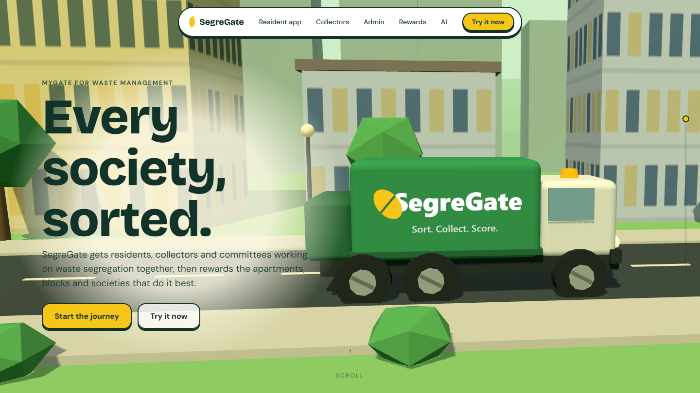
</p>

> **Try it:** clone this repo and follow [Getting started](#getting-started).

## The problem

Most societies tell residents to segregate, but nobody checks whether it happens. Residents don't know what goes where, collectors can't give feedback, and committees have no data. SegreGate closes that loop the way MyGate did for visitors and security.

## Three roles, one platform

| Role | What they get |
|---|---|
| **Resident** | Scan an item to find the right bin, with a reason. Ask waste questions in chat. See their flat's score, streak, badges and rank. Get pickup reminders and society announcements. |
| **Admin** (committee / facility manager) | Dashboard with contamination rate, waste volume by category, block and floor heatmap, trends and forecasts. Manage blocks, flats, residents and collectors. Run challenges, post notices, download weekly reports. |
| **Collector** | See the pickup route and bins. Scan a bin QR and rate it clean, minor or major contamination, with an optional photo. Log weights by category. These checks feed the leaderboard. |

Sign-in is role-based. Residents join with a society invite code and flat number, the admin approves them, and the admin creates collector accounts.

## Resident app

Built with Tauri 2, React, TypeScript and Tailwind. One codebase runs on desktop and Android.

<p align="center">
  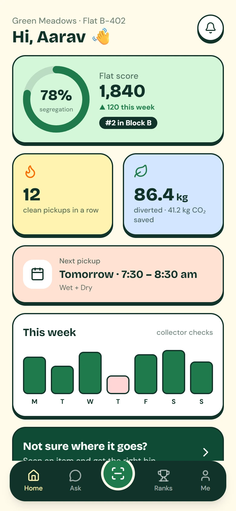
  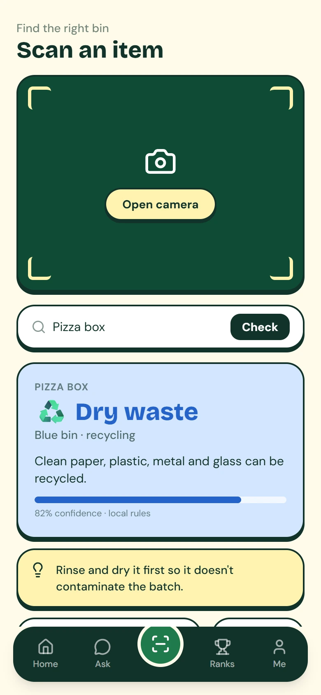
  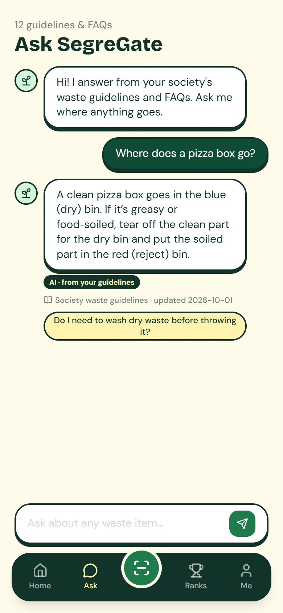
  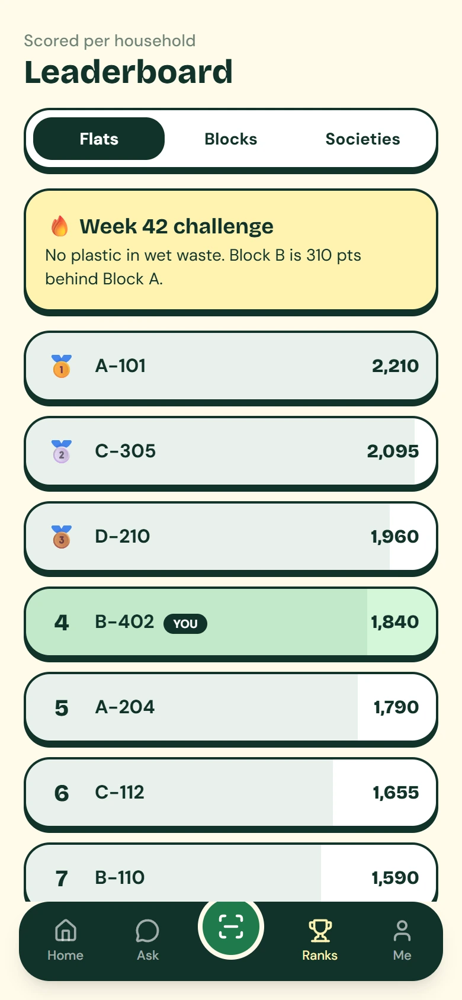
  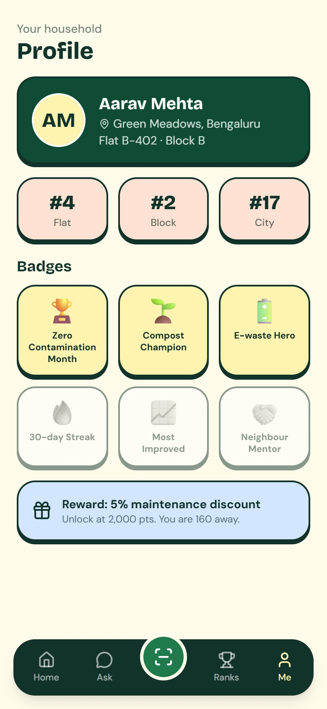
</p>

- **Home:** flat score, segregation ring, clean-pickup streak, kg diverted and CO₂ saved, next pickup, weekly collector-check chart, society notices and events.
- **Scan:** live camera viewfinder plus item lookup. Returns the correct bin (wet, dry or reject), the reason, a handling tip and a confidence score.
- **Ask:** a RAG chatbot grounded in the society's own guidelines. Every answer cites its source and last-updated date.
- **Ranks:** flat, block and society leaderboards, scored per household so large and small blocks compete fairly, plus a "most improved" board.
- **Me:** badges (Zero Contamination Month, E-waste Hero, Compost Champion), ranks and reward progress.

## Admin dashboard

React + Vite web app for the committee.

<p align="center">
  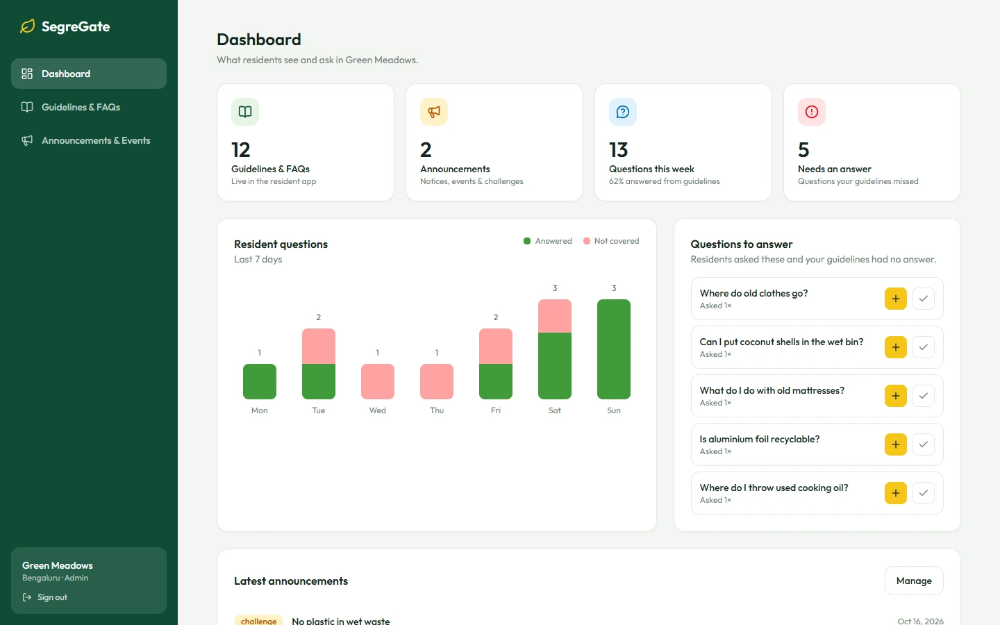
  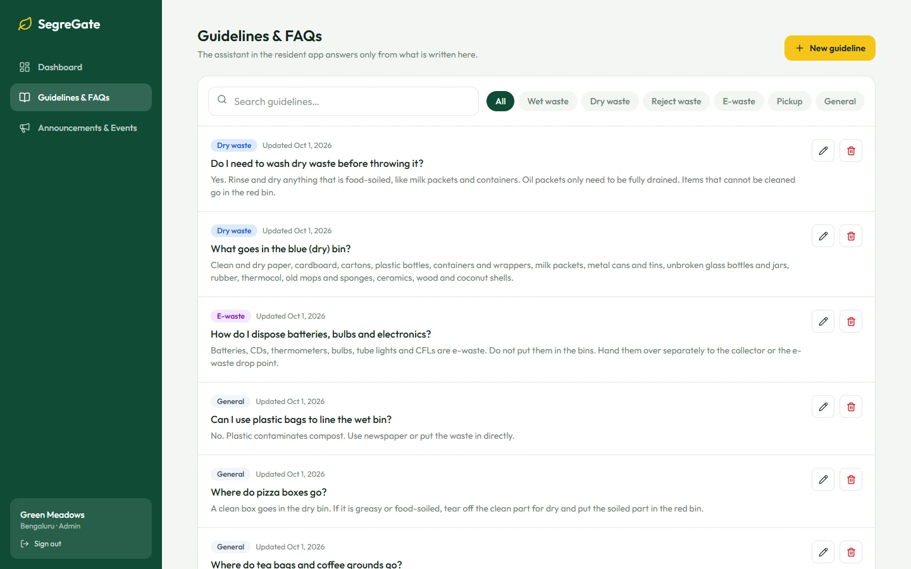
</p>
<p align="center">
  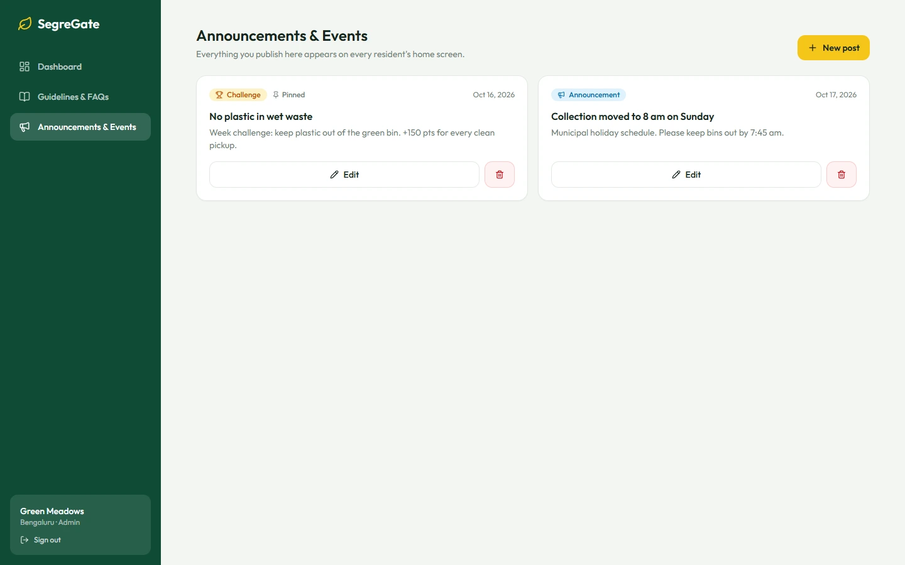
  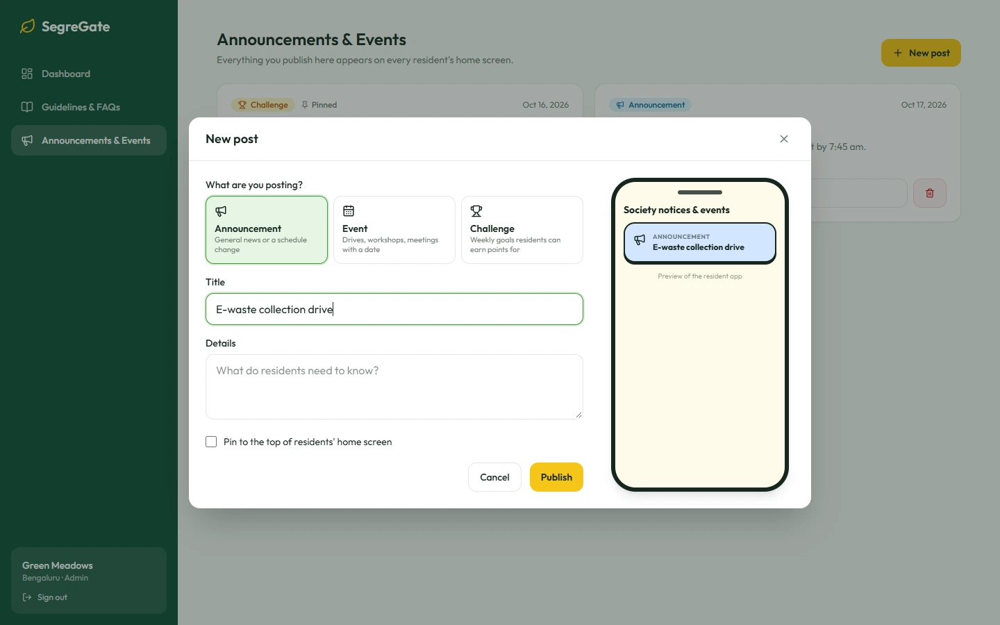
</p>

- **Guidelines & FAQs:** add, edit and delete the rules the assistant answers from. Changes reach every resident's phone within seconds.
- **Announcements, events and challenges:** post dated events, notices and weekly challenges with a live phone preview. Pin important posts.
- **Question-gap analytics:** every question residents ask is logged. Questions the guidelines couldn't answer are ranked, and an admin can turn one into a guideline in one click.
- **Insights:** resident-question chart, contamination heatmap by block and floor, waste volume trends and forecasts, downloadable weekly reports.
- **People & rewards:** manage blocks, flats, residents and collectors, and set committee-funded perks.

## Collector app

<p align="center">
  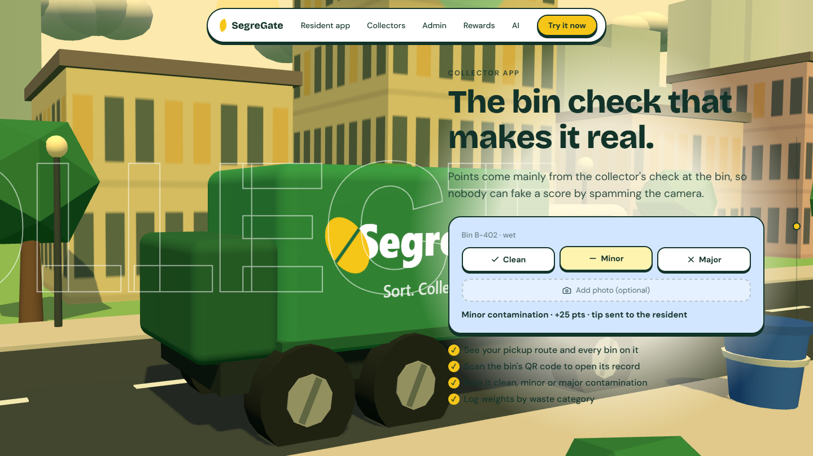
</p>

- View the pickup route and every bin on it.
- Scan a bin's QR code to open its record.
- Rate it **clean**, **minor** or **major** contamination, with an optional photo.
- Log weights by waste category.
- Points come mainly from the collector's check, so a score can't be faked by spamming the camera.

## Gamification

<p align="center">
  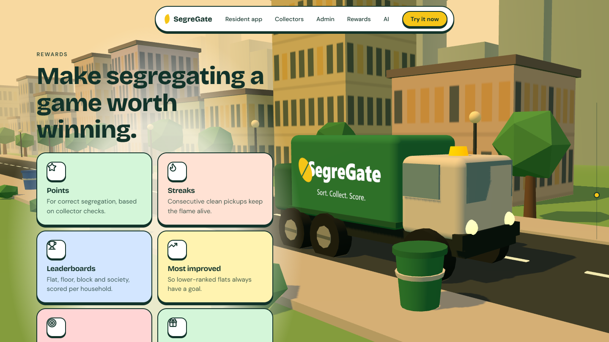
</p>

- **Points** for correct segregation, based on collector checks.
- **Streaks** for consecutive clean pickups.
- **Badges** such as Zero Contamination Month, E-waste Hero and Compost Champion.
- **Leaderboards** at flat, floor, block and society level, scored per household, plus a most-improved board.
- **Challenges & seasons:** weekly goals ("No plastic in wet waste"), monthly seasons with a reset, and society-vs-society events.
- **Rewards:** committee-funded perks like a maintenance discount, a gift voucher, or a trophy for the winning block.
- **Impact numbers:** kg diverted from landfill and CO₂ saved, as a personal and society total.

## Multi-society by design

- Many societies on one platform. Every record belongs to a society, so each society only sees its own data.
- A city-wide leaderboard across societies, plus each society's internal block and flat rankings.
- A shared model: corrections from every society improve one classifier, and each society keeps its own local rules (for example, different municipal collection days).

## ML and data science

<p align="center">
  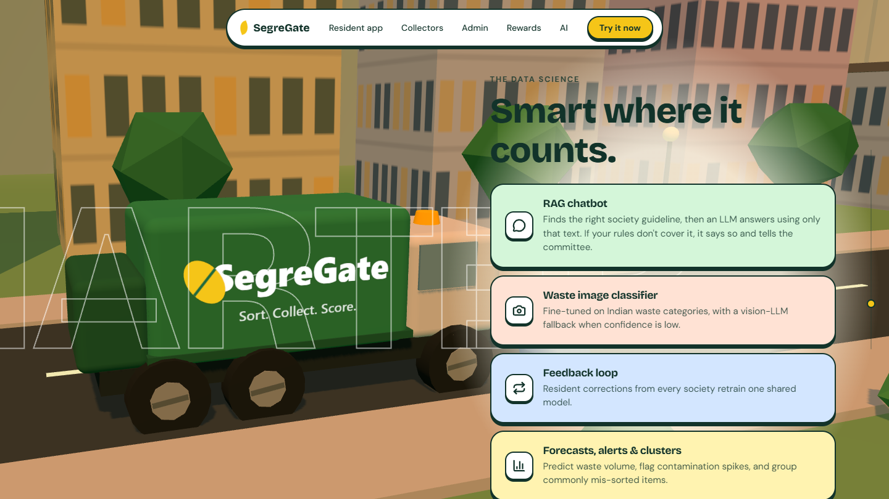
</p>

- **Image classifier** fine-tuned on Indian waste categories, with a vision-LLM fallback when confidence is low.
- **RAG chatbot** grounded in local waste rules. Retrieval picks the relevant society guidelines and an LLM (Groq) answers using only that text. If the rules don't cover the question, it says so and flags the gap for the committee.
- **Feedback loop:** resident corrections retrain the shared model.
- **Forecasting** of waste volume, **anomaly alerts** for contamination spikes, and **clustering** of commonly mis-sorted items.

## Landing page

A scroll-driven 3D journey built with Three.js, GSAP ScrollTrigger and Lenis. A procedurally modelled garbage truck drives through a city, lifting bins into its hopper as you scroll, while the sky moves from morning to night.

<p align="center">
  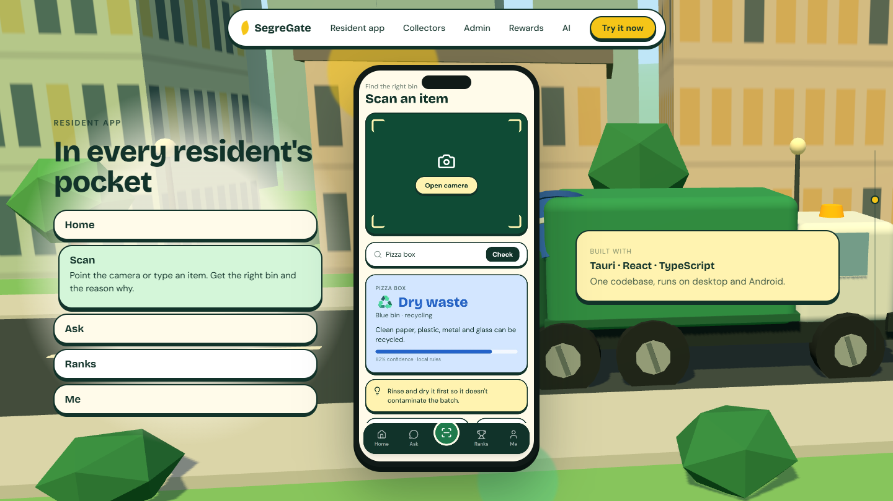
  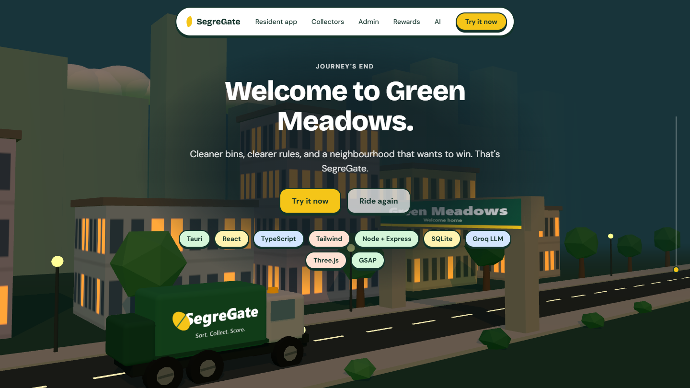
</p>

## Architecture

```
 Resident app (Tauri + React)  ──┐
 Admin dashboard (React/Vite)  ──┼──►  Node + Express REST API  ──►  Supabase (Postgres)
 Collector app                 ──┘            │
                                              └──►  Groq LLM (RAG answers)
```

- Every table carries a `society` column for multi-tenancy.
- Admin write endpoints are gated by an admin key, and all input is validated server-side.
- The resident app polls for guidelines and announcements, and falls back to bundled content when offline.

## Tech stack

**Frontend:** React, TypeScript, Tailwind CSS v4, Vite, Tauri 2 (Rust), Three.js, GSAP, Lenis
**Backend:** Node.js, Express (Vercel serverless), Supabase (Postgres)
**AI / ML:** Groq API (LLM), retrieval-augmented generation, image classification, forecasting
**Mobile:** Android via Tauri

## Repository layout

```
resident-web/   Resident web app (React + Vite): block + flat login, announcements, Ask
resident-app/   Full resident app (Tauri + React + TypeScript)
admin/          Admin dashboard (React + Vite)
landing/        3D landing page (Three.js + GSAP)
lib/            API routes, Supabase store, RAG logic
api/            Vercel serverless entry for the API
supabase/       Database schema (schema.sql)
legacy/         Original single-page classifier
docs/           Screenshots
```

## Getting started

Requires Node 20+, and Rust for the Tauri app.

```bash
cp .env.example .env        # add GROQ_API_KEY (Supabase is optional locally)
npm install
npm start                   # API on http://localhost:3000
```

Without Supabase credentials the API uses an in-memory store, so you can develop offline.

```bash
cd admin && npm install && npm run dev          # http://localhost:5173  (password: admin123)
cd resident-web && npm install && npm run dev   # http://localhost:1421
cd resident-app && npx tauri android dev --host 127.0.0.1   # full app on a USB-connected Android phone
cd landing && npm install && npm run dev        # http://localhost:5174
```

## Deploying

1. Create a Supabase project and run `supabase/schema.sql` in the SQL editor.
2. Deploy the repo root as the API on Vercel with `GROQ_API_KEY`, `SUPABASE_URL`, `SUPABASE_SERVICE_KEY` and `ADMIN_PASSWORD`.
3. Deploy `resident-web`, `admin` and `landing` as separate Vercel projects (set each Root Directory). Set `VITE_API_URL` on the first two to the API URL.
